# 💫 About Me:
🎓 BCA 1st Year Student 💻 Aspiring Software Developer 🌱 Currently Learning Programming & Web Development 🚀 Exploring New Technologies 🎯 Building Projects and Improving My Skills 🤝 Open to Learning and Collaboration

## 🌐 Socials:
    

# 💻 Tech Stack:
   
# 📊 GitHub Stats:
 
 

## 🏆 GitHub Trophies

---

<!-- Proudly created with GPRM ( https://gprm.itsvg.in ) -->
